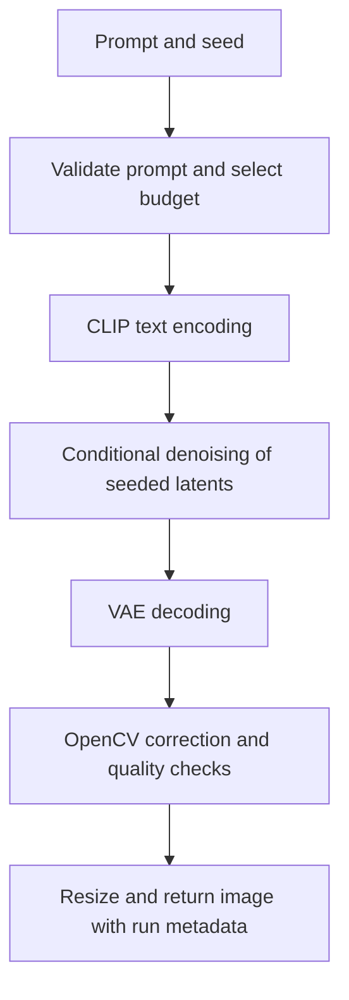

# P3 Mobile Text-to-Image Blueprint

*Initial design for review. See the [current implementation design](docs/DESIGN.md) for the revised COCO and TAESD study.*

Start with **BK-SDM-Tiny-2M at 512 × 512**, an eight-step sampler, and a classical OpenCV pass. Use the same checkpoint in a self-hosted GPU demo and a native phone benchmark. The demo target is **about 10 seconds from submit to visible image**. The phone benchmark measures the cost of running generation on the device itself.

## Model and runtimes

| Role | Choice | Rationale |
| --- | --- | --- |
| Baseline | `CompVis/stable-diffusion-v1-4`, 25 steps, 512 × 512, original decoder | The teacher model for BK-SDM. Use FP32 on the GPU host and the standard Core ML FP16 export before weight compression on the phone. [SD v1.4 model card](https://huggingface.co/CompVis/stable-diffusion-v1-4), [Apple Core ML exports](https://github.com/apple-aiml-research/ml-stable-diffusion#using-ready-made-core-ml-models-from-hugging-face-hub) |
| Main candidate | `nota-ai/bk-sdm-tiny-2m` | Its pruned, distilled U-Net has about 330M parameters versus 860M for SD v1.4. Nota publishes both Diffusers weights and a palettized Core ML package. [Tiny-2M model card](https://huggingface.co/nota-ai/bk-sdm-tiny-2m), [Core ML package](https://huggingface.co/nota-ai/coreml-bk-sdm) |
| One-step comparison | `IDKiro/sdxs-512-dreamshaper` | A downloadable 512 × 512 checkpoint with its own one-step recipe. Trial it on the host if the step sweep leaves too little latency headroom. Check object binding and diversity before using it for any profile. [SDXS model card](https://huggingface.co/IDKiro/sdxs-512-dreamshaper) |

Apply three optimizations in sequence. Use the compact U-Net, sweep **DPM-Solver++** from 25 steps down to 4, and test reduced precision. On the host, compare FP32 with FP16. On Core ML, compare the standard FP16 export with 6-bit weight palettization for the denoiser and text encoder. Measure storage and runtime separately because the runtime's handling of compressed weights depends on the hardware and compute unit. As a decoder experiment, try the distilled **TAESD** decoder on identical final latents and verify latent scaling, output range, and color before selecting it. [DPM-Solver++ documentation](https://huggingface.co/docs/diffusers/main/en/api/schedulers/multistep_dpm_solver), [Core ML weight compression](https://github.com/apple-aiml-research/ml-stable-diffusion#weight-compression-6-bits-and-higher), [TAESD integration](https://huggingface.co/docs/diffusers/main/en/api/models/autoencoder_tiny)

EdgeFusion is a reference for a future two-step variant. Its authors report sub-second generation on an Exynos 2400 with a separately distilled checkpoint and an optimized NPU pipeline. They also report weak results from applying their initial LCM recipe to the public BK-SDM-Tiny checkpoint. [EdgeFusion paper](https://arxiv.org/html/2404.11925v1)

## Prompt to image

Use a responsive Gradio UI with one persistent Diffusers worker that runs the downloaded weights. The provisional native target is **iPhone 15 Pro with Core ML**, using a small Swift benchmark harness. Confirm access to the phone and a Mac with Xcode before committing to that target. [Apple Swift pipeline](https://github.com/apple-aiml-research/ml-stable-diffusion#image-generation-with-swift)

Pass the user’s prompt into the checkpoint’s tokenizer and CLIP text encoder. Show the token limit and flag overlong prompts so the user can preserve their object and relation clauses. For “Two red apples to the left of a blue mug, with a yellow banana behind the mug,” check apple count, each object’s color, left-of placement, and depth separately. Save the seed, model revision, native resolution, precision, and actual denoiser calls with each benchmark result.

## Latency and fallback

| Profile | Starting settings | Selection rule |
| --- | --- | --- |
| Balanced | 512 × 512, 8 steps, reduced precision | Default candidate for the warm demo and phone. |
| Quality | 512 × 512, 12 steps, reduced precision | Use when requested and the measured time and memory budget can fit it. |
| Low resource | 6 steps. Use 384 × 384 on the host and upscale to 512. Use the 512 Core ML export on the phone, with `reduceMemory` if memory is tight. | Select when predicted latency, available memory, or device thermal state rules out the default. Test a separate 384 export before enabling lower native resolution on Core ML. |

Allocate **0.5 s** to validation and text encoding, **6.0 s** to denoising, **1.2 s** to decoding, **0.3 s** to CV, and **2.0 s** to queueing, image encoding, and delivery. These are design budgets. Test submit-to-visible-image p95 on both phone and laptop browsers with a warm worker, then report cold starts and concurrent traffic separately.

Preload the chosen host profile and cap the queue. Show queued, generating, and processing states, with a retryable error for overload or timeout. If no local profile fits, offer the hosted route and label where it runs. For a failed image quality check, retry at most once when the measured remaining budget can fit a complete run. Record fallback, retry, and failure rates alongside latency.

## Classical vision pipeline

Work on decoded pixels at native resolution. Tune thresholds on a small calibration set that includes clean images, deliberately dark scenes, and images with injected speckles and color casts.

| Stage | Operation and guardrail |
| --- | --- |
| Artifact detection and correction | Use a 3 × 3 median residual to find isolated bright or dark pixels. Limit candidate masks to tiny connected components away from strong edges, then repair those pixels with Telea inpainting. Flag larger defects for the quality gate. [OpenCV inpainting](https://docs.opencv.org/4.x/d7/d8b/group__photo__inpaint.html) |
| Edge-aware filtering | Use a small bilateral filter on luminance when flat regions show noise. Compare edge strength before and after to catch lost detail. [OpenCV image filtering](https://docs.opencv.org/4.x/d4/d86/group__imgproc__filter.html) |
| Color and contrast | Use a bounded Lab chroma adjustment when near-neutral midtones show a consistent cast. For low contrast, blend mild CLAHE on Lab luminance. Check for added clipping and excessive color shift after conversion back to RGB. [OpenCV CLAHE](https://docs.opencv.org/4.x/d6/db6/classcv_1_1CLAHE.html) |
| Automated quality assessment | Log near-blank frames, clipped-pixel fraction, Laplacian variance as a blur signal, and repaired area. If a filter makes a usable image worse, return the raw decode. Route a near-blank or badly corrupted decode to the bounded retry. |
| Resizing | Preserve aspect ratio. Use area interpolation for smaller previews and bicubic interpolation for low-resolution outputs. Record native resolution separately from display size. [OpenCV resize](https://docs.opencv.org/4.x/da/d54/group__imgproc__transform.html) |

## Benchmarks and ablations

| Comparison | Change to isolate |
| --- | --- |
| A → B | SD v1.4 → Tiny-2M. Both at 25 steps with the same solver, guidance, backend, and precision. |
| B → C | Tiny-2M step sweep at 25, 12, 8, 6, and 4 steps. Keep resolution and precision fixed. |
| C → D | FP32 → FP16 on the host. Separately test FP16 → 6-bit weight palettization on Core ML at a fixed step count. |
| D → E | Original VAE → TAESD at a fixed denoising configuration. Time decoding and compare fine detail on the same latents. |
| Selected decode → full CV | Score raw and processed versions of the same images at equal output size. Drop color correction, edge filtering, artifact repair, and the quality gate one at a time and record how often each stage fires. Compare resize methods at the same output size. |
| Balanced → low resource | Test step count, native resolution, and memory-saving load policy separately where supported, then measure the combined fallback profile. |

**Quality.** Start with 1,000 fixed MS COCO 2017 validation images and one caption per image. Score cosine similarity using a pinned CLIP encoder and compute Kernel Inception Distance (KID) against the matching real-image set with identical preprocessing. Report sample size and uncertainty. Use a fixed GenEval subset for counts, color binding, and spatial placement, plus a small human-scored set of three-object prompts. Run a labeled subset on the phone to check whether its export changes alignment. [COCO dataset](https://cocodataset.org/#download), [CLIP paper](https://arxiv.org/abs/2103.00020), [KID paper](https://arxiv.org/abs/1801.01401), [GenEval](https://github.com/djghosh13/geneval)

**Efficiency.** On the same phone and OS version, compare cold start, warm p50 and p95, per-stage times, peak process memory, and complete inference bundle size. Use at least 30 measured warm runs per configuration and record thermal state, backend, and any failures. On the GPU host, report peak GPU memory and process RAM separately. If the baseline exceeds phone memory, try the same staged loading policy on both checkpoints. If it still fails, record the failure and use matched Tiny-2M runs to quantify step and precision changes on that device.

**Selection.** Pair prompts and seeds across variants and use the same initial latent when shapes match within a runtime. Keep retries off for the ablations and measure them separately for the end-to-end demo. Plot CLIP similarity and composition pass rate against latency, with peak memory and bundle size next to each point. Choose the fastest profile that meets a composition floor set on the calibration set. Keep paired examples of missed objects, swapped attributes, smeared details, excessive filtering, and resource failures with the relevant run settings.

## Build order and submission

1. **Prove the runtime.** Run baseline and Tiny-2M on one GPU host and the selected phone. Capture timings for text encoding, denoising, decoding, and delivery before tuning.
2. **Choose the profiles.** Run the step and precision sweeps, then test the decoder and classical CV stages. Freeze settings before scoring the held-out prompts.
3. **Package the demo.** Deploy a warm GPU worker and verify the URL, progress states, errors, and submit-to-image timing from both phone and laptop. Add a Dockerfile or single launch command, pin dependencies and model revisions, and pass any credentials through the runtime environment.
4. **Assemble the evidence.** Include source, architecture diagram, design, benchmark results, ablation, and failure cases in GitHub. Generate `eval_P3_<TeamID>.md` with comma-separated team USNs on the very first line and metrics in the official rubric order.

Before implementation, confirm the available phone and toolchain, GPU hosting budget, and official evaluation template. The template supplies the exact metric order for the submission file.
