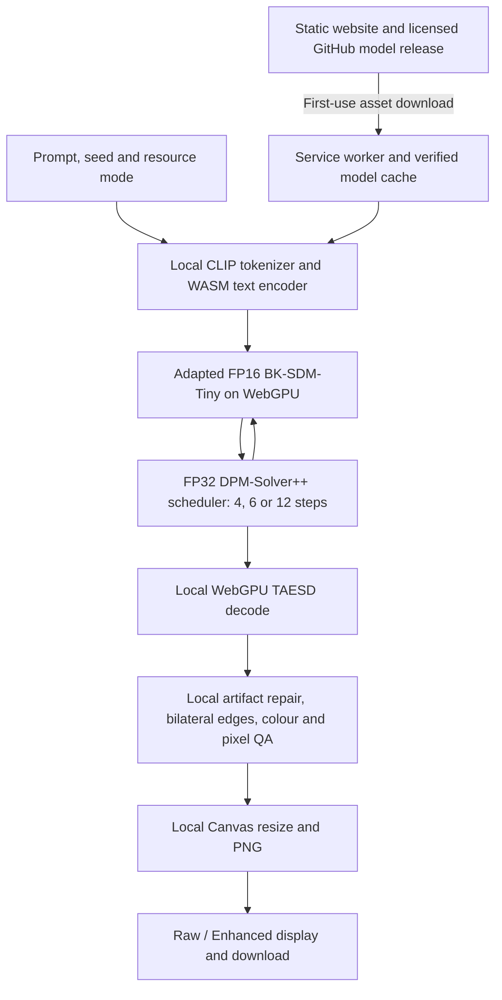

# Browser generation on the visitor's device

This is a separate, measured implementation of P3. Prompt encoding, diffusion, decoding, resizing and classical CV run on the visitor's device. A static host supplies application files and weights. There is no generation endpoint, prompt upload or server inference fallback. No T4 or external GPU was used.

The on-device path is working. Semantic accuracy remains inadequate for the full problem statement: every four-, six- and twelve-step configuration failed all 16 exact composition tests. The ten-second result applies to cached, resident six-step generation on the tested Poco F6; it does not include the first download or model initialization.

## Architecture



The same trained T38 rank-4 COCO adapter is fused into the browser denoiser. Its SHA-256 is `dcffb4476adcf795689bd710679eaaaf96d19bf5a7ec7f23bf0a46e2cd295c49`. The export pins BK-SDM-Tiny-2M, TAESD and ONNX Runtime Web 1.31.1. [Export manifest](../browser/model-manifest.json) · [Published model files and licenses](https://github.com/solaxien/O-n-Eyes/releases/tag/browser-models-v3)

Optimizations are FP16 neural layers, the lightweight denoiser, reduced sampling steps, TAESD latent decoding, batch-one sequential classifier-free guidance, independently released components and optional session retention. Sequential guidance makes **two denoiser calls per step**. The scheduler retains FP32 arithmetic. Weight shards target 64 MiB; the text embedding is a single 72.38 MiB tensor and runs through WASM.

On the Poco F6, the GPU text encoder had approximately 16% relative RMSE against its reference, including a later-token discrepancy. FP32, disabled graph optimization and removal of subgroups did not resolve it. Production therefore uses local WASM for text. Final v3 reference probes measured relative RMSE **0.001160** for WASM text, **0.026741** for the WebGPU denoiser and **0.009774** for the decoder. All outputs were finite. These are single-input diagnostics, not proof of numerical equivalence; the denoiser discrepancy remains unexplained. The JS tokenizer matches four pinned reference examples, including a Unicode accent; it is not a complete replacement for all Python text-cleaning behaviour.

## Physical phone validation

Device: Poco F6, model 24069PC21I, Android 16, Chrome 156, Qualcomm Adreno 7xx, non-fallback WebGPU adapter with `shader-f16`. The browser reported an 8 GB memory class and a 128 MiB maximum storage-buffer binding. This is a coarse capability report, not available memory.

For the decisive original test, mobile data and Wi-Fi were disabled, the project ADB reverse tunnel was removed, and an uncached network request failed. The cached website then reloaded offline and generated a previously unused prompt/seed. The laptop's Uvicorn inference process was stopped. The phone produced a PNG in **16.536 seconds** and issued **8,844 GPU compute dispatches**. CDP captured only locally cached script GETs during generation, with zero inference requests. The original network settings were restored.

The fresh request asked for a yellow banana to the right of a blue cup. The output omitted the banana and did not meet the requested relation. Pixel QA accepted it, correctly illustrating that pixel checks do not measure semantic correctness. [Offline image](browser/offline-result.png) · [Isolation state, network events, timings and image hashes](browser/evidence.json)

The durable [published URL](https://on-eyes-device-lab-t38.brawnymoss1024.chatgpt.site) was also tested after stopping both laptop static servers and temporary tunnels. Its largest 75,890,688-byte model shard and decoder downloaded through the public static proxy with matching checksums; its 28,747,738-byte WASM runtime also matched. Remaining model bytes were transferred through ADB into that origin's cache to avoid a second full cellular download, with SHA-256 recomputed on the phone. This was an asset-only development transfer, not inference or generated-image transfer. With both phone networks disabled, the published page reloaded and generated two new prompts/seeds in **18.333 s cold and 8.033 s resident**, with **8,844 and 8,759 GPU dispatches** respectively. PSS peaked at 2,298 MiB across Chrome. Network settings were restored. The full first-download timing above belongs to the earlier public origin; it is not a measured full first download from the durable host.

The first public model download had a **771.79-second network envelope**, about 12.86 minutes on the phone's mobile connection. This comes from retained Resource Timing entries: the original 600-second automation wait expired while the page continued downloading. It is not a precise click-to-ready measurement. Verified model graphs and weights total **896,382,552 bytes / 854.857 MiB**. Initial cache usage, including the runtime and auxiliary files, was **926,927,302 bytes**. Download cost is separate from generation latency.

## Matched sampling-step study

All rows use the same 16 prompts/seeds from `data/composition.jsonl`, native 256 px, guidance 7.5, the adapted model, the same decoder and full CV, displayed at 512 px. Each has a warm-up outside the scored set. All 16 timed results have resident models. Timers end after the displayed image decodes; these original studies did not separately instrument viewport intersection or a paint fence. The final UI additionally scrolls the mobile output into view and waits two animation frames. No inference retries or quality-based resampling were used. Global CLIP and YOLOS composition scoring ran afterward on the local laptop.

| Configuration | CLIP cosine ↑ | FID | Visible latency p50 / p95 (s) | Observed Chrome peak PSS (MiB) | Model size (MiB) | Exact composition |
| --- | ---: | --- | ---: | ---: | ---: | ---: |
| 4 steps / 8 denoiser calls | 0.2853 | N/A, N=16 | 5.877 / 6.237 | 1,553 | 854.857 | 0/16 |
| 6 steps / 12 calls | 0.3001 | N/A, N=16 | 7.744 / 7.848 | 2,372 | 854.857 | 0/16 |
| 12 steps / 24 calls | 0.3053 | N/A, N=16 | 14.648 / 14.900 | 1,518 | 854.857 | 0/16 |

Six steps reduced median latency by about 47% relative to twelve, with CLIP lower by 0.00515. Four steps saved more time but reduced CLIP further. Count/color/position clause passes were **5/36, 2/31, 0/17** at four steps; **5/36, 3/31, 0/17** at six; and **7/36, 4/31, 0/17** at twelve. FID is omitted because this small composition diagnostic lacks an adequate matched real-image distribution.

Memory is Android's aggregate PSS for **all Chrome package processes**, sampled about once per second. It includes other tabs, shared-process attribution and driver-accounted memory; it is not a precise WebGPU allocation measurement. The six-step run includes model initialization before its warm-up, while the twelve- and four-step runs reused those sessions. Their lower peaks therefore do **not** establish a memory improvement from those step counts. The separate unloaded-session offline test peaked at 2,418 MiB PSS. Sampling can miss short peaks.

Run order was 6 → 12 → 4, without randomization. Battery sensor temperature rose from 36.8°C to about 40.7°C; the phone was USB-powered. Warm-state reuse, temperature and sequential order limit causal timing comparisons. These are pilots on one device, not population benchmarks or a universal latency promise.

[All four-step outputs](browser/steps-4.jpg) · [All six-step outputs](browser/steps-6.jpg) · [All twelve-step outputs](browser/steps-12.jpg)

## Classical CV ablation

A separate 16-image six-step phone run applied every variant to the **same native decoded pixels**, before the same 512 px resize. It did not regenerate an image for each variant. Diagnostic variant rendering adds work and is excluded from the primary latency study above.

| Variant | CLIP cosine | Count / color / position passes | Exact |
| --- | ---: | --- | ---: |
| Raw decode and resize | 0.300378 | 7/36 · 3/31 · 0/17 | 0/16 |
| Full CV | 0.300116 | 5/36 · 3/31 · 0/17 | 0/16 |
| Omit isolated artifact repair | 0.300084 | 5/36 · 3/31 · 0/17 | 0/16 |
| Omit bilateral edge stage | 0.300419 | 7/36 · 3/31 · 0/17 | 0/16 |
| Omit colour stage | 0.300116 | 5/36 · 3/31 · 0/17 | 0/16 |
| Omit quality gate | 0.300116 | 5/36 · 3/31 · 0/17 | 0/16 |

Isolated-speckle repair activated on seven images; bilateral processing activated on all sixteen. Colour and rejection thresholds did not activate on this cohort. Removing the edge stage slightly improved measured alignment, and full CV reduced two count-clause passes. No semantic improvement is claimed. The detector threshold is 0.55, so small pixel changes can also change a thresholded detector result. A separate known-defect test verifies isolated hot-pixel correction; a uniform failed-decode test verifies rejection and raw preservation. Classical CV cannot restore missing objects, anatomy or spatial relationships.

## Modes, compatibility and failure cases

Auto uses the memory class and, while its worker is retained, observed diffusion time to choose four or six steps for a nominal warm ten-second budget. Initialization remains additional. It lowers requested 384 px generation to 256 px on smaller reported memory classes. Explicit modes allow the user to trade speed for sampling steps. Keeping models loaded reduces repeat latency but retains memory; they are released after two idle minutes or when leaving the page. Unchecking this option releases components after each stage.

The optional 384 px / twelve-step mode completed two physical-phone renders in **71.13 and 66.12 seconds** with staged model release. It is labelled slow and is never selected by Auto. The larger output still omitted the requested blue cup. [Sharper image, missing object](browser/quality384-missing-cup.png)

Local Edge on the Windows laptop used its **Intel Gen-12LP GPU**, not a server, and displayed six-step images in **19.60 s initially and 5.59 s with resident models**. Layouts at 1365 and 390 px had no horizontal overflow. Raw/Enhanced switching, the 75-token error and the unsupported-WebGPU state were checked. A temporary/private test profile hit its storage quota; a normal persistent profile worked. First download, storage eviction, unsupported FP16, heat, memory pressure and tab suspension remain practical limits. Safari/iOS and other phones have not been validated.

The browser export omits the content safety classifier. The model's Open RAIL use restrictions still apply. No claim is made that the pixel gate provides safety classification. Model/runtime licenses ship with the site and release.

## Reproduce

The public site serves only static assets. For a local CPU-only asset host, the Docker path is:

```sh
docker build -f Dockerfile.device -t p3-device . && docker run --rm -p 7860:7860 p3-device
```

Open `http://localhost:7860` on that computer. Remote phones need HTTPS or an explicitly configured trusted-local ADB route. The Dockerfile is supplied but Docker was unavailable on the development laptop; actual container runtime validation remains pending.

The browser build itself is independently reproducible:

```sh
cd browser
npm ci
npm test
npm run build
cd ..
python scripts/serve_device.py --port 7860 --remote-models https://github.com/solaxien/O-n-Eyes/releases/download/browser-models-v3
```

To regenerate model exports on a local CUDA machine, install `requirements-web-export.txt` and run `python -m p3.export_browser --device cuda --out .models/browser/new-export`. Use a new directory when the protocol changes. Set `P3_BROWSER_MODELS` to that directory before building the UI. Export reference inputs and outputs accompany the release; `browser/src/probe.js` checks a component on the device. Published v3 is pinned to the export code hash in its own protocol; later code must not silently overwrite it.

For device evaluation, authorize USB debugging and forward a local port to `chrome_devtools_remote`. Run `scripts/benchmark_browser.cjs` with `--origin`, `--tab`, `--out`, `--manifest`, `--adb`, and optional `--python`, `--keep-loaded`, `--warmup`, `--mode` or `--offline`. Offline mode temporarily disables Wi-Fi/data and restores their original state. It removes only the project's `tcp:7861` reverse mapping. Use fresh output directories. `--cv-study` creates isolated CV variants from each native decode. Preserve the captured source and image hashes.

Import results with `python -m p3.import_browser_run --source <capture> --out <new-scoring-directory> --kind enhanced`, then use the existing `p3.benchmark score` command with the same manifest. `python -m scripts.report_browser` recreates this study's machine-readable evidence and contact sheets from the original captures. Current checks: 29 Python regressions and 8 browser numerical/CV/resource tests passed. These checks complement the physical browser runs; they do not substitute for them.

Historical RTX 4050 COCO and native ARM results remain in their original documents. They are not relabelled as browser timings or scores. A controlled unoptimized browser-model baseline and a distribution-level browser quality study remain outstanding.
