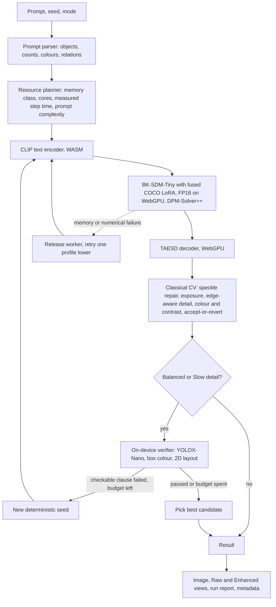

# System design: P3 on-device text-to-image (Team T38)

## 1. Problem and goal

P3 asks for text-to-image generation that uses far fewer resources than a conventional diffusion model while keeping the image faithful to the prompt, on a mobile device. Our rule is strict: prompt encoding, diffusion, decoding, classical CV, prompt checks, retries and fallback all run on the visitor's device. There is no generation server, no cloud image API and no hidden server fallback.

Target device: Poco F6 (Android 16, Chrome, Adreno GPU through WebGPU). The same page also runs on laptops with WebGPU.

## 2. Architecture

Source map: `browser/src/worker.js` (generation pipeline), `resources.js` (planner, fallback chain, simulated budgets, readiness report), `selection.js` (retry and candidate policy), `verifier.js` (detector pre and post-processing and clause checks), `vision.js` (classical CV), `prompt.js` (prompt contract and quality hints), `app.js` (orchestration and UI).

## 3. Model and adaptation

- **Base:** BK-SDM-Tiny-2M, a block-removed and distilled Stable Diffusion U-Net (architecture-level compression).
- **Adaptation:** a rank-4 attention LoRA trained by the team on 1,000 COCO train2017 image-caption pairs (`p3/train_lora.py`, record in `docs/training.json`), fused into the exported U-Net.
- **Decoder:** TAESD instead of the full VAE.
- **Export:** `p3/export_browser.py` writes FP16 ONNX graphs in 64 MiB shards with reference inputs and outputs for numerical checks on the device.

## 4. Optimisation strategies

| Strategy | Where | Evidence |
| --- | --- | --- |
| Lightweight architecture (Tiny U-Net) | Model choice | Historical RTX study; GPU variants in `p3/benchmark.py` |
| Reduced precision (FP16) | Export | Historical FP32 vs FP16 study |
| Fewer sampling steps (20, 12, 6, 4) with DPM-Solver++ | `resources.js` profiles | Phase 1 phone run |
| Lightweight decoder (TAESD) | Export | Historical study |
| Weight-only INT8 MatMul (experimental) | `p3/quantize_browser.py` | Agreement report; publish only if the phone shows a gain |
| Staged session release | `worker.js` | Memory proxy in phone runs |

## 5. Adaptive generation and fallback

Auto mode chooses a profile from the browser-reported memory class, core count, prompt complexity and the measured time per step from earlier local runs. On a memory, non-finite or worker failure the app releases the worker and retries one profile lower (Slow detail, Balanced, Eco, Preview). For demonstrations, the Device budget menu can simulate a 4 GB phone (the planner then picks lighter profiles) or a memory failure on the first attempt (the real fallback chain then runs). Simulated runs are labelled in the run metadata.

## 6. Prompt consistency

- **On the device:** after Balanced and Slow detail generations, YOLOX-Nano (Apache-2.0, 3.6 MB, WASM) detects COCO objects. The verifier checks presence, exact counts, colour inside the central part of each box, and left, right, above, below and beside from box centres with a 5% margin. Depth relations and non-COCO objects are reported as not verifiable. A JavaScript-versus-Python parity test guards the detector path.
- **Offline (final numbers):** `p3/score.py` uses a different detector (YOLOS-Tiny) and CLIP crop colours, so the system is never graded by its own selector. Clauses it cannot judge are excluded and counted separately.

## 7. Classical computer vision

| Requirement | Implementation |
| --- | --- |
| Resizing and resolution | Profiles at 256 and 384 px; aspect-preserving canvas resize to the 512 px display |
| Colour correction and enhancement | Bounded gamma exposure correction (applied equally to all channels to keep hues), neutral colour balance, bounded contrast |
| Edge-aware processing | Bilateral base layer with bounded detail recovery |
| Quality assessment | On-device pixel-health score; offline BRISQUE (`scripts/offline_iqa.py`); CLIP, KID and FID offline |
| Artifact detection and correction | Isolated speckle repair; checks for blur, exposure, clipping, colour cast and 8-pixel decoder grid, each with its threshold and action; accept-or-revert gate keeps raw pixels when enhancement increases clipping or distorts edges |

Each stage records whether it ran, why it was skipped, its time and how many pixels it changed.

## 8. Evaluation protocol

- **Phone:** `scripts/run_phase1.ps1` runs the 20-step reference, Balanced, Eco and Preview on the same 20 prompts and seeds, with models kept loaded and a warm-up, then imports the images, scores them offline and writes the report table with file hashes.
- **Distribution quality:** `scripts/run_gpu_quality.ps1` generates 1,000 COCO captions on the laptop GPU with the same weights, steps and resolution, and reports CLIP, KID (primary at this size) and FID.
- Phone timings and GPU quality numbers are reported separately and never mixed.

## 9. Limitations

- Images are generated at 256 px (384 px in Slow detail) and look soft when shown at 512 px.
- Composition accuracy on complex prompts is low; retries help only where the detector can check a clause.
- The verifier covers 80 COCO classes and 2D layout only; there is no on-device image-text alignment model.
- Browser memory reporting is coarse; Chrome PSS is a proxy, not a GPU allocation measurement.
- The first visit downloads about 855 MiB of model files.
- Only the Poco F6 and one Windows laptop have been tested; Safari and iOS are untested.
- INT8 depends on WebGPU support for `MatMulNBits`, which must be confirmed on the device.

## 10. Ethics and licences

Model weights keep their upstream licences (BK-SDM-Tiny and Stable Diffusion under CreativeML OpenRAIL-M, TAESD MIT, YOLOX Apache-2.0). The browser export has no content safety classifier; the Open RAIL use restrictions still apply, and this is stated in the app documentation. Prompts never leave the device. Generated images inherit biases from web-scale training data and should not be presented as real photographs.
