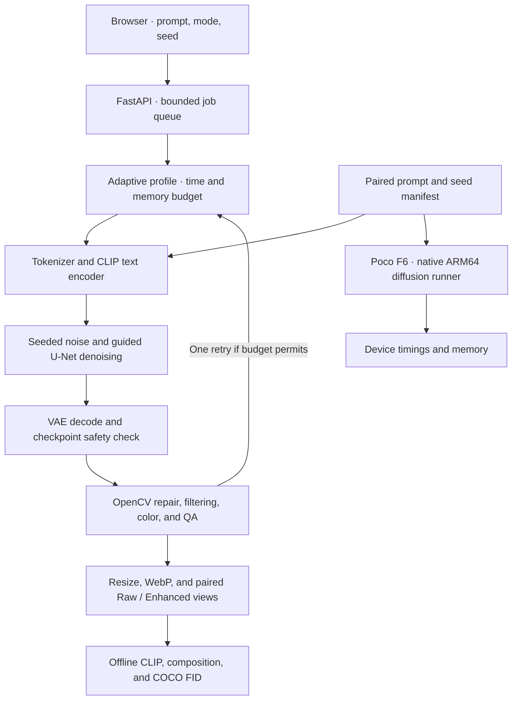

# P3 System Design

## Runtime layout

The hosted path runs Python, PyTorch, Diffusers components, and OpenCV on the inference host. Browser requests carry only prompt and profile settings. The browser polls the job endpoint for queue, encoding, denoising, decoding, and packaging states. A single worker serializes model use and the queue caps outstanding work at two requests. Finished images expire after three minutes and remain in bounded process memory.

The mobile performance track uses the same model families on the physical Poco F6. Its native runtime and weight formats differ from the PyTorch worker. Each speed or memory comparison is made within one device and backend. The public site presents those tracks separately.

## Generation and budget

The worker tokenizes the whole prompt and rejects input above the checkpoint’s CLIP context length. It encodes positive and empty conditioning, starts from seed-derived noise, applies classifier-free guidance, runs DPM-Solver++ updates, and decodes once through the VAE. It runs the checkpoint safety check before returning an image. The generator stores model revision, precision, effective steps and size, stage timings, and applied CV operations in run metadata.

| Profile | Default configuration |
| --- | --- |
| Reference | SD v1.4, FP32, checkpoint scheduler, 50 requested steps, 512 px |
| Full quality | BK-SDM-Tiny-2M FP16, DPM-Solver++ at 20 steps, TAESD and COCO LoRA |
| Balanced | Tiny FP16, 8 steps, 512 px |
| Low resource | Tiny FP16, 6 steps, 384 px, bicubic upscale to 512 px |
| CPU fallback | Tiny FP32, 5 steps, 320 px, bicubic upscale to 512 px |

The compact checkpoint removes U-Net blocks and distills the teacher’s outputs. The six-row study adds reduced precision, fewer sampling steps, DPM-Solver++, TAESD, and a COCO LoRA. The adapter trains rank-4 attention updates with the original U-Net, text encoder, and VAE weights frozen. It sees one pass over 1,000 captioned train2017 images and uses a separate 300-image val2017 manifest for evaluation.

Auto mode starts with the full quality profile when its warm-up estimate, remaining time, and free GPU memory fit. It can choose Balanced or Low resource instead. A GPU out-of-memory error can trigger one smaller run if time remains. The same one-retry limit applies to unusable decodes. The browser shows the actual resolution, denoiser calls, decoder, and adapter used.

## Classical vision

All measurements and corrections run at native resolution. The pipeline uses median residuals and a gradient mask to localize isolated speckles, and Telea inpainting on tiny masks. Bilateral filtering on Lab luminance reduces flat-region noise while retaining edges. Low-contrast scenes receive a small CLAHE blend, and near-neutral midtones can trigger a bounded chroma correction. The gate checks clipping, edge retention, luminance range, and suspected artifact fraction. If a correction exceeds the clipping or edge-loss guard, the raw decode remains available. Area interpolation downsamples previews and bicubic interpolation enlarges low-resolution outputs.

The pixel checks address localized defects. Missing objects, attribute swaps, and reversed positions are evaluated offline against the original prompt. The automatic composition score combines exact detector counts, CLIP crop color labels, and a 5% image-axis margin for relative centers. The failure analysis distinguishes detector misses from visible generation errors.

## Measurement scope

The host benchmark records the exact model, sampler, resolution, precision, decoder, and adapter for each run. Within a fixed shape, the same FP32 seed-derived noise is cast to each tested precision. The first six comparisons use raw decoded images. CV ablations reuse row 6's pixels. FID uses common generated IDs and the matched COCO references. At 300 images it is a comparison within this study, with the sample size reported next to each value. CLIP cosine and composition checks measure complementary properties.

Worker latency covers synchronized encoding, denoising, decoding, safety, and CV. Browser latency additionally covers queue, transport, and image decode. The offline quality study scores raw model outputs before the public worker's safety check. Its latency and bundle size use the components present in those offline runs. PyTorch reports peak allocated GPU bytes and process RSS is sampled independently. Mobile reports the native artifact bytes and physical process memory measured by its runner.
