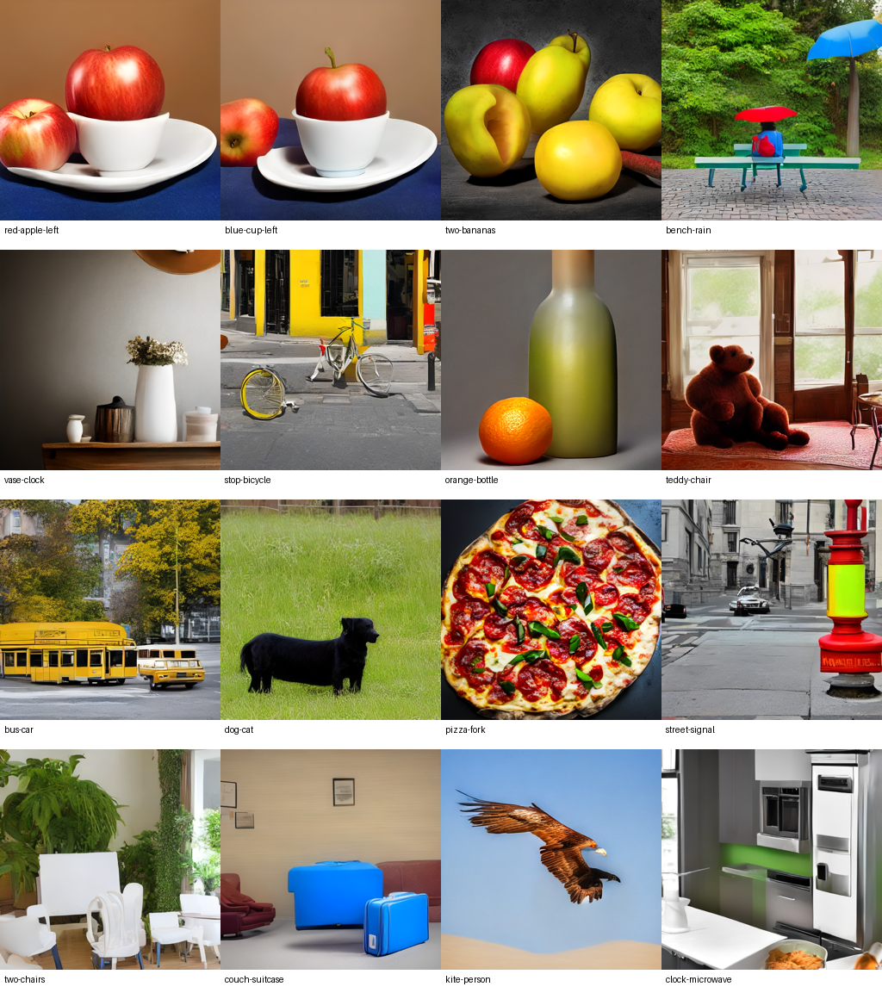

# Composition audit

This is a model-assisted visual review of the 16 historical `tuned` raw outputs, not an independent human study. It explains the published automated 0/16 result without changing that result. All frames are shown below in manifest order.

| Prompt ID | Visible result | Review of requested clauses |
| --- | --- | --- |
| red-apple-left | Two apples, one inside a white cup | Wrong apple count, cup color, placement |
| blue-cup-left | Two apples and a white cup over blue cloth | Wrong count, cup color and relation |
| two-bananas | Several round yellow/green fruits and a red apple | Missing recognizable bananas, wrong count |
| bench-rain | Blue and red umbrellas, teal bench, red/blue bag | Extra umbrella and wrong bench/bag attributes |
| vase-clock | Several vessels on a shelf; cropped brown object above | Required round black clock not established |
| stop-bicycle | Distorted bicycle with separated wheel | Missing clear red stop sign and placement |
| orange-bottle | One orange fruit left of one olive-green bottle | Counts and relation visibly satisfied; color-score disagreement |
| teddy-chair | Brown bear on reddish furniture | Missing blue chair and red umbrella |
| bus-car | Yellow bus left of yellow vehicle | Car is not white |
| dog-cat | One black animal on grass | Missing white cat |
| pizza-fork | Pizza filling the frame | Missing fork |
| street-signal | Red/green street fixture and lamps | Required traffic light, hydrant, and bicycle combination absent |
| two-chairs | More than two white chairs with green plants | Wrong chair count |
| couch-suitcase | Two blue cases and brown seating | Wrong suitcase count |
| kite-person | Bird of prey against sky | Wrong meaning of kite, missing person and beach |
| clock-microwave | Kitchen appliances | Missing requested clock and green bottle |

The orange/bottle row has both detector counts and its relation marked true in the original score. Both crop-CLIP color checks are false. Visual inspection supports orange fruit color; the bottle is olive/yellow-green and less clear-cut. This is a concrete reason not to present automated exact accuracy as verified human accuracy. The other rows contain substantial visible errors regardless of detector performance. A future human annotation pass should use two independent reviewers, retain disagreements, and score each clause before adjudication.

The revised scorer preserves the original threshold and decision rule. It adds detection boxes/confidences, predicted crop colors, and whether a color was evaluable after a count match. Count failures currently make dependent color and position clauses fail, so aggregate clause rates are strict end-to-end rates, not independent color or position recognition accuracy. Object detection can miss small/occluded objects or count duplicates. Crop CLIP can be distracted by the background and lighting. Relations use centers and a 5% margin; depth and containment are not evaluated.

The new host pilot tests CFG 5.0 against 7.5 at the same 20 steps, seed, resolution, decoder, and adapter. It is an exploratory compute-bounded test on this diagnostic set. A better score here must be confirmed on held-out prompts before changing the app's default. No retry or best-of-many selection is hidden in the comparison.
